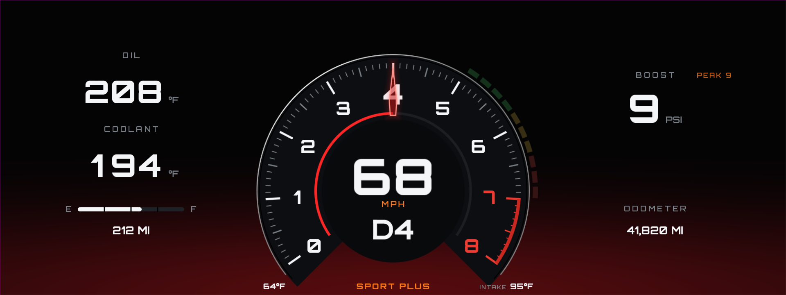

# ARC Cluster

A custom instrument cluster for BMWs with iDrive 7 (MGU head unit, Live Cockpit Professional): one large
tachometer in the middle, the speed and gear inside it, and big readouts either side. It is an app for the
[MGU Store](https://github.com/robertnisipeanu/mgu-store) and draws through
[cluster-render](https://github.com/robertnisipeanu/idrive-apps/tree/main/native/cluster-render) on the cluster's
`panel` target (1920x720, over the stock gauges).

- **Tachometer:** a thin bezel lit from the top left, a red arc that fills with the revs, a "red glass" needle,
  numerals that grow as the needle comes up to them, and shift lights outside the scale (green, yellow, then red
  over the last 2,000 rpm, all flashing red from the redline).
- **Centre:** the speed, large, and the gear under it: `D4` in drive, `S4` with the lever in the sport gate, and the
  number alone while shifting by hand. The D has a round bowl, so it doesn't read as an O.
- **Left:** oil and coolant temperature, a fuel bar and the range.
- **Right:** boost, with the drive's peak beside its label, and the odometer. Optionally boost as
  [a number and a segmented bar](docs/arc-boost-bar.png) (0-25 psi, a segment a psi, red from 21, the peak an orange marker over it).
- **Bottom row:** outside temperature, drive mode and intake air temperature.
- **Drive-mode colours:** the needle, the lit rev arc, the background's glow and the mode's name follow the drive
  mode: [orange in Comfort, red in Sport and Sport Plus, blue in Eco Pro](docs/arc-modes.png) (red in Adaptive).
  The redline marks, shift lights and boost bar keep their colours. A mode change re-sends those pictures, about
  1.8 MB, once.
- **Backgrounds:** Dusk (above, the default), [Dusk from the top](docs/arc-dusk-top.png) (the red coming down from
  the top, pure black along the bottom so BMW's seat-belt light and gear letter show without black boxes round
  them) or [Horizon grid](docs/arc-grid.png).

The stock gauges are hidden while it is on; BMW's warning and indicator lights stay on top. Developed on a G20
M340i.

## Install

1. Have the MGU Store on the head unit (root SSH access is needed once for that; see its README).
2. In the Store: Settings → **Add source** → `cruzen991/Cluster`, channel **Branch: main** (or your own fork; a
   private repository needs a token in Settings → Accounts).
3. Install **ARC Cluster**. The Store builds it on the head unit (it takes BMW's app SDK from a BMW app already on
   the unit; none is in this repository) and installs cluster-render first.
4. Open the app once from *All apps*. The cluster changes when the panel is free; the app's screen says what the
   cluster is doing.

Needs cluster-render 0.4.2 or later (it uses 53 layers and 4 glyph atlases, 5 with the boost bar; used with 0.5.9). To remove it,
uninstall it in the Store: the stock cluster comes back as soon as the app's layers go.

## Settings

| Setting | |
|---|---|
| Show on the cluster | on / off (also the app's first button); off stays off across restarts |
| Background | Dusk (default), Dusk from the top, or Horizon grid |
| Boost readout | *Number* (default), or *Number and bar*: the figures smaller, a segmented bar under them |
| Driver camera above the cluster | on (default): the tach is placed so no tick sits under the Driving Assistant Professional camera; off for the full-size tach |
| Speed | mph or km/h |
| Temperatures | °F or °C |
| Redline | 7000 for a B58; the tach's scale and the shift lights follow it |
| Needle sweep at start | on / off (the *Needle sweep* button sweeps on demand) |
| Shift lights | on / off |
| Bottom strip (test) | *Covered* (default) or one of the test modes that leave parts of BMW's own bottom bar uncovered (below) |
| Retry after BMW pop-ups | off (default): wait for BMW's own content to leave the panel rather than retrying against it |
| Demo data on the cluster | off (default); on shows made-up values, for testing parked |

Fixed, no longer settings: Arc style only, boost as gauge pressure, a 59 l tank (the M340i's), pre-loaded drawing,
smooth needle response, the needle updated 60 times a second, no torque readout, the stock gauges always hidden.

## Turning it on and off

- **In the app:** the first button, *Cluster on / off*, or Settings → *Show on the cluster*.
- **What off does:** the app closes its connection to cluster-render, which drops every layer of a client whose
  connection goes: the stock cluster is back within about 3 seconds, whatever state the app was in. The same
  happens if the app crashes or is stopped.
- **If the head unit's screen is unusable:** over SSH, `systemctl stop cluster-render` takes every app's content off
  the cluster at once.

## Can it brick the car or leave the stock cluster stuck?

**Bricking:** the app writes nothing to the instrument cluster, any control unit, the head unit's firmware or its
coding; only into its own data folder. It asks cluster-render to show pictures in the cluster's `panel` slot, the
display-sharing mechanism BMW's own head-unit software uses; the cluster decides what to show and keeps it only while
asked. The real bricking risk in this setup is in rooting the head unit and installing the Store, not in this app.

**Stuck or restarting cluster:** the realistic failure is the cluster rejecting the content and restarting, or the
picture flickering. Built in:

| Protection | What it does |
|---|---|
| Never takes the slot from BMW | cluster-render never unmaps BMW's content, and the app waits for the slot to be free by default |
| Drawn under the telltales | the panel is drawn over the gauges and under the warning and indicator lights |
| Off releases everything | nothing of the app is left on the cluster |
| Guard | the picture lost 3 times in 2 minutes, the head unit or renderer going down within 20 s of it first showing, or 5 drawing errors in a minute: one strike each; 2 strikes turn the cluster off until you turn it on again in the app (its screen says *Off for safety* and why). The picture going away within 5 s of you changing a setting is not counted |
| Stale data | no speed or engine speed for 1.5 s: the needle drops to zero and the readouts show dashes |

## Before you drive with it

- **Check it parked first,** engine running: compare the needle with the stock cluster (switch the app off and on).
- **Warning lights:** with it on, check the indicators, seat-belt, brake and check-engine lights show. If any is
  hidden, switch it off.
- **What hiding the stock cluster also hides:** the stock gauges and the centre area under the panel (navigation,
  media, the trip computer and possibly Check Control texts and driver-assist displays). When BMW's own content
  takes the slot (a door-open warning, the speech dialog, phone pop-ups) the stock cluster shows until it goes.
- **Speed** is the car's own vehicle speed without the stock speedometer's deliberate over-read: expect 1-3 mph
  lower than the stock one at highway speeds.
- **The Waze HUD map** uses the same scene as the panel, so cluster-render never shows both at once.
- **Head-unit updates** can stop third-party apps; reinstall from the Store.

## What it shows and where the values come from

| Readout | Signal (SOME/IP, what the head unit already receives) |
|---|---|
| Tachometer, shift lights | `CDS.statusEngineSpeed2`, or `BasicDataSet.statusEngineSpeed` when that is shown to agree and comes more often (the app's screen says which) |
| Speed | `Vehicle2.statusCarSpeed2` |
| Gear | `VehicleInformation.statusGearboxDrive`; S and manual from `MDrive.dataDisplayGearbox` (the gearbox's own display data) if the car sends it, else from the lever (`BasicDataSet`) and paddles (`FES.operationPaddleSwitch`): manual entered from D by a paddle is taken to end 8 s after the last tap |
| Oil, coolant (refreshed every 10 s) | `CDS.statusEngineTemperature` |
| Boost and its peak | `FES` `displayBoostPressure` (x 0.01 bar, gauge); the peak ignores samples over 35 psi and resets after the engine has been off a minute |
| Fuel, range, odometer | `KombiIF.statusRangeTankStatus` |
| Drive mode | `FES.statusFESVehicleDynamicSwitchHMI` |
| Outside temperature | `EnvironmentalInformation.ExteriorTemperature` |
| Intake air temperature | read from the engine unit (DME) every 2 s, **read-only** (the kit refuses anything but ReadDataByIdentifier / OBD reads) |

The signal decoding is the idrive7-apps kit's (`kit/runtime/car.js`).

## How it is drawn

- **Pre-loaded:** everything (the dial, the lit arc's pieces, the numerals, the shift lights, glyph atlases for
  the figures) is uploaded once at the start, about 12 MB of cluster-render's 16 MB. While driving, no pixels are
  sent: the app moves the needle, turns the covers that reveal the lit arc and scales the numerals with small
  messages, and the readouts are GPU layers that draw their figures from the atlases (a new value is a few
  numbers); the boost bar is a shader too, its segments lit by one number. If the renderer refuses (an older
  cluster-render, or its memory full with other apps), the app falls back to a simpler rotating-needle drawing by
  itself and its screen says why.
- **60 frames a second, one write each:** each frame's needle, arc, numerals and lights go to cluster-render in one
  write, so they reach the cluster in the same flush (30 and 20 a second were tried on the car; 60 was smoothest).
- **Following the revs:** the car sends a new rpm about 9 times a second. The needle starts gliding to each reading
  the moment it arrives, over the time to the next one, so it moves continuously but about one reading behind the
  engine. A jump of 800 rpm or more in one reading (a shift, a blip) is shown in 50 ms instead. Smoother paths
  through the readings (speed-matched curves, a short playback delay) were simulated against the car's irregular
  timing; none was better in every case without the needle swinging past the revs, so this one stays.
- **Not waiting on the head unit:** the app runs at the priority robertn's Waze-on-cluster uses (PRIO_MEDIUM,
  background 150; the kit's default is PRIO_LOW, 200), and a full memory collection, which pauses the app, runs
  only when memory has grown (the kit used to force one every 1.5 s while the app's screen was open). The app's
  screen shows how many needle frames ran late (over 25 ms) in the last minute and the longest gap.
- **BMW's black box:** on a G20 the cluster draws a black box at x 1406-1597, y 342-419 while a layout covers BMW's
  gear letter in the bottom strip. Nothing important is
  drawn there: boost sits above it. *Bottom strip → Open over BMW's gear letter only* leaves that 80x60 letter
  uncovered (x 1380-1460, y 660-720), which should stop the box altogether; the other test modes open more of
  the strip.

## Files

| Path | |
|---|---|
| `apps/mx_classic_cluster/arc.js` | the Arc layout: the dial, the growing numerals, the readout panels, the backgrounds |
| `apps/mx_classic_cluster/preload.js` | the pre-loaded drawing: the lit arc's pieces and covers, the lights, the glyph atlases and their shader |
| `apps/mx_classic_cluster/cluster.js` | the layers on cluster-render, the needle's motion, the sweep |
| `apps/mx_classic_cluster/main.js` | the app: car data, on/off, safety, its own screen |
| `apps/mx_classic_cluster/rpmsource.js` | which engine-speed signal drives the needle |
| `apps/mx_classic_cluster/gearmode.js` | D / S / manual for the gear readout |
| `apps/mx_classic_cluster/faces.js`, `fx.js` | drawing helpers and the moving parts (also the older styles' code, unused) |
| `apps/mx_classic_cluster/guard.js` | turns the cluster off by itself after repeated failures |
| `apps/mx_classic_cluster/modes.js` | the drive mode as text |
| `apps/mx_classic_cluster/cluster_render_client.js` | cluster-render's Node client (MPL-2.0) |
| `apps/mx_classic_cluster/test.js` | `node apps/mx_classic_cluster/test.js` |
| `kit/` | the app kit from [cauliflowermossgrape/idrive7-apps](https://github.com/cauliflowermossgrape/idrive7-apps) (MIT) |

The app's folder and id stay `mx_classic_cluster` so an installed copy updates in place and keeps its settings.

Preview on a PC (no SDK, nothing installable): `python3 kit/tools/build.py --preview-only mx_classic_cluster`,
then `node kit/tools/preview.js dist/mx_classic_cluster preview wait=8 render`.

## Credits and licences

The app's own files: MIT (`LICENSE`). Orbitron (`kit/runtime/fonts/orb*.json`): SIL Open Font License 1.1, The
Orbitron Project Authors. `cluster_render_client.js`: MPL-2.0 (Robert Nisipeanu). `kit/`: MIT (cauliflowermossgrape,
`kit/LICENSE-idrive7-apps`). Findings used from Cluster Layouts and the author of waze-on-cluster (pre-load
everything, stream only video). Not affiliated with or endorsed by BMW AG.
