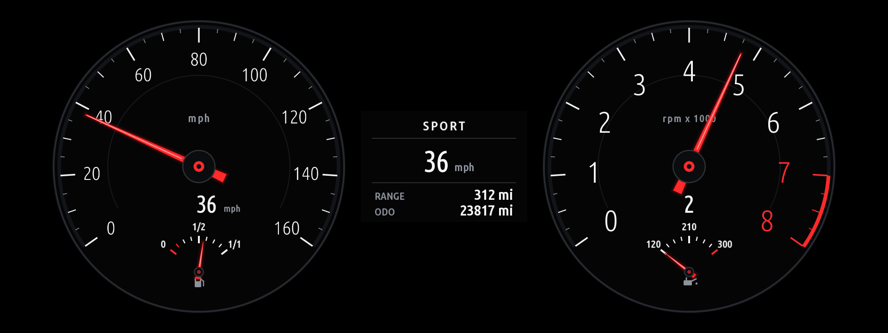
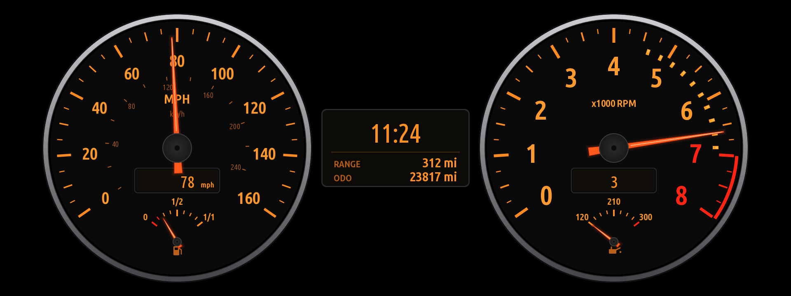

# Classic Cluster

Classic BMW round dials with orange needles on the instrument cluster of an iDrive 7 car (MGU head unit, Live Cockpit
Professional cluster): a speedometer with a fuel gauge, a tachometer with an oil-temperature gauge, the warm-up
segments that go out as the oil warms (off by default), two LCD windows for digital speed and gear, and a centre panel
with the drive mode, the speed, the range and the odometer. By default the stock gauges are hidden behind a black background while the dials are on; BMW's
warning and indicator lights are drawn by the cluster above it.

Two gauge styles (Settings → *Gauge style*): **Sport** (the default: rimless faces, white markings, red needles, a
large white digital speed) and **Classic** (the first design: chrome rings, orange markings, orange-red needles). Both
read 0-160 mph by default (0-260 km/h in km/h). The centre panel shows the current drive mode as text (Comfort,
Sport, Sport Plus, Eco Pro, ...), the speed in large figures, the range and the odometer.

It is an app for the [MGU Store](https://github.com/robertnisipeanu/mgu-store). It draws through
[cluster-render](https://github.com/robertnisipeanu/idrive-apps/tree/main/native/cluster-render) on the cluster's
`panel` target (1920x720, over the stock gauges). The Store installs cluster-render with it.

> **Status: untested on a car.** Tested on a PC only: on a stubbed head unit with demo data, against a stand-in for
> cluster-render that checks every message against its protocol and composites what the cluster would show. Read
> "Before you drive with it" below.

## Install

1. Have the MGU Store on the head unit (root SSH access is needed once for that; see its README).
2. Push this folder to a GitHub repository of your own (it can be private: add a token in the Store's
   Settings → Accounts).
3. In the Store: Settings → **Add source** → `<you>/<repo>`, channel **Branch: main**.
4. Install **Classic Cluster**. The Store builds it on the head unit (it takes BMW's app SDK from a BMW app already on
   the unit; none is in this repository) and installs cluster-render first.
5. Open the app once from *All apps*. The dials go on the cluster when the panel is free; the app's screen says
   what the cluster is doing.

To remove it: uninstall it in the Store. The stock cluster comes back as soon as the app's layers go.

## Turning it on and off

- **In the app:** the first button, *Cluster on / off*, or Settings → *Show on the cluster*. The choice is saved, so
  off stays off after the car restarts.
- **What off does:** the app closes its connection to cluster-render. cluster-render drops every layer of a client
  whose connection goes, so the dials disappear and the stock cluster is back within about 3 seconds, whatever state
  the app was in. The same happens if the app crashes or is stopped.
- **Uninstalling** in the Store removes the app and its layers; the cluster renderer can be removed after it.
- **If the head unit's screen is unusable:** over SSH, `systemctl stop cluster-render` takes every app's content off
  the cluster at once.

## Can it brick the car or leave the stock cluster stuck?

**Bricking:** this app writes nothing to the instrument cluster, any control unit, the head unit's firmware or its
coding. It only writes into its own data folder on the head unit. What it does to the cluster is ask cluster-render to
show a picture in the cluster's `panel` slot, the same display-sharing mechanism BMW's own head-unit software uses;
the cluster itself decides what to show and keeps it only while asked. The real bricking risk in this whole setup is
in rooting the head unit and installing the Store, not in this app.

**Stuck or restarting cluster:** the realistic failure is the cluster rejecting the content and restarting, or the
dials flickering. These protections are built in:

| Protection | What it does |
|---|---|
| Never takes the slot from BMW | cluster-render's panel never unmaps BMW's content (`panel_take_over_stock = 0`), and this app waits for the slot to be free by default rather than retrying against BMW's pop-ups (setting *Retry after BMW pop-ups*, off) |
| Drawn under the telltales | cluster-render's notes record the panel as drawn over the gauges and under the warning and indicator lights, checked on a car |
| Off releases everything | off closes the connection; nothing of the app is left on the cluster |
| Guard: losses | the dials lost within 10 s of showing, 3 times in 2 minutes, not to BMW's own content: one strike |
| Guard: restarts | the head unit, the cluster renderer or the app going down within 20 s of the dials first showing: one strike at the next start |
| Guard: errors | 5 errors in the drawing loop within a minute: one strike |
| Guard: off | 2 strikes turn the cluster off and keep it off across restarts; the app's screen says *Off for safety* and why. Turning it on again in the app clears the strikes |
| Stale data | no speed or engine speed for 1.5 s: needles to zero, LCDs `---` |

cluster-render has its own mapping guard, but for the panel it only logs; it never disables the panel. That is why
this app has one. One side effect: switching the car off within 20 s of the dials first appearing counts as a
strike, so two very short starts in a row can turn it off; turn it back on in the app.

Not handled: if the app froze without crashing, the connection would stay open and the needles would stop moving.
The app's own loop catches its errors, but a freeze is not something it can see from inside.

## What it shows and where the values come from

| Dial | Signal (SOME/IP, what the head unit already receives) |
|---|---|
| Speedometer, 0-160 mph (inner km/h scale) or 0-260 km/h | `Vehicle2.statusCarSpeed2` |
| Tachometer, scale to redline + 500 rpm, red from the redline | `CDS.statusEngineSpeed2` |
| Warm-up segments (setting *Warm-up lights on the tach*, off by default): lit from the rpm allowed now to the redline; all lit at 40 °C oil or colder, none from 80 °C | `CDS.statusEngineTemperature` (oil) |
| Oil temperature, 120-300 °F or 50-150 °C | `CDS.statusEngineTemperature` |
| Fuel, 0-1/1 | `KombiIF.statusRangeTankStatus` (litres) over the tank size setting |
| Gear LCD: P, R, N, D1-D8 | `VehicleInformation.statusGearboxDrive` / `DataPowerTrain2` |
| Drive mode (centre panel, text) | `FES.statusFESVehicleDynamicSwitchHMI` (`actualValueModeDrivingExperience`), decoded with the idrive7-apps Live Data app's table; *DRIVE MODE ---* until the car sends one |
| Range and odometer (centre panel) | `KombiIF.statusRangeTankStatus` |

The signal decoding is the idrive7-apps kit's (`kit/runtime/car.js`), which other apps already use on cars.

## Settings

Show on the cluster; stock cluster hidden (default) or showing between the dials; mph or km/h; °F or °C; classic orange or white dial lighting; redline (7000 for a B58); the needle
sweep at start; dials only or black sides; tank size (59 l for a G20 M340i); moving the dials apart, together, up or
down; needles drawn by a shader (default) or as turned images; retry after BMW pop-ups (off); demo data on the
cluster (never, by default).

The *Needle sweep* button sweeps whatever the *Needle sweep at start* setting says (that setting only controls the
automatic one); the app's screen says when it runs, or why it did not (the cluster off, or the car moving).

The app's own screen in the head unit always uses the HMI's own image (software rendering), never the Store's GPU
renderer. Version 0.1.0 let the kit switch to the GPU renderer once it found it running, which put a blank surface
over the app's screen and took the iDrive controller with it; 0.2.0 fixes that. If that blank screen ever shows
again, press the controller's MENU or HOME button, or hold the volume knob down until the head unit restarts.

## Before you drive with it

- **Check it parked, engine running, before anything else.** Put the car in P, start it, open the app, and compare
  the needles with the stock cluster (switch the app off and on with the first button). Then drive slowly in a car
  park.
- **Warning lights.** cluster-render's notes say the panel is drawn under the telltales (checked on one car, not on
  yours). Check anyway: with the dials on, turn the indicators on and look for the seat-belt, brake and check-engine
  lights at start. If any is hidden, switch the app off.
- **What hiding the stock cluster also hides.** The black background covers everything the cluster draws under the
  panel: the stock speedometer and tach, the centre area (navigation, media, the trip computer) and, possibly, Check
  Control message texts and cruise-control and driver-assist displays there. The warning lights stay above it. When
  BMW's own content takes the slot (a door-open warning, for one), the stock cluster shows until it goes. If you rely
  on adaptive cruise or lane-keeping displays, set *Stock cluster* to *Shows between the dials*.
- **Speed.** The needle and the LCD show the car's own vehicle speed as sent on the bus. The stock speedometer
  reads a little high on purpose (the law lets it over-read, never under-read); this one shows that value without the
  margin, so expect it to read about 1-3 mph lower than the stock one at highway speeds.
- **Stale data.** If no speed or engine speed has come for 1.5 s, the needles drop to zero and the LCDs show `---`,
  rather than freezing on an old value.
- **No demo data on the cluster** unless you switch the "Demo data on the cluster" setting on, which is for parked
  testing.
- **Who wins the cluster.** BMW's own content (door-open warnings, the speech dialog, phone pop-ups) can take the
  panel slot; the dials then wait until it is free. Expect them to disappear and come back.
- **The Waze HUD map** uses the same scene as the panel, so cluster-render never shows both at once.
- **Head-unit updates.** A BMW software update can stop third-party apps; reinstall from the Store.

## Files

| Path | |
|---|---|
| `apps/mx_classic_cluster/faces.js` | the artwork: faces, needles, hubs, warm-up segments, LCDs (pure JavaScript) |
| `apps/mx_classic_cluster/cluster.js` | the cluster layers through cluster-render, needle smoothing, the sweep |
| `apps/mx_classic_cluster/main.js` | the app: car data, on/off, safety rules, its own screen |
| `apps/mx_classic_cluster/modes.js` | the drive mode as text |
| `apps/mx_classic_cluster/guard.js` | turns the cluster off by itself after repeated failures (above) |
| `apps/mx_classic_cluster/cluster_render_client.js` | cluster-render's Node client (MPL-2.0, unchanged) |
| `apps/mx_classic_cluster/test.js` | `node apps/mx_classic_cluster/test.js` |
| `kit/` | the app kit from [cauliflowermossgrape/idrive7-apps](https://github.com/cauliflowermossgrape/idrive7-apps) (MIT) |

Preview on a PC (no SDK, nothing installable): `python3 kit/tools/build.py --preview-only mx_classic_cluster`,
then `node kit/tools/preview.js dist/mx_classic_cluster preview wait=8 render`.

## How the cluster is drawn

The faces, LCDs, centre panel, warm-up segments and hubs are image layers that are never turned: the kind of layer
the Waze map, the one thing checked on cars, also is. The faces are drawn once (about 3.8 MB uploaded at start,
within cluster-render's shared link budget); only the LCD windows and the centre panel are redrawn, about 200 KB/s
while the speed changes.

The needles, four ways (setting *Needles drawn by*):

- **Shader (default):** each needle is an unturned quad over its sweep; a fragment shader draws it at the angle in
  one uniform, so moving a needle sends a few bytes. Smooth.
- **Redrawn images:** the needle is drawn by the app into an unturned image over its sweep, and only the pieces that
  changed are sent, at most 8 times a second. Uses only the kind of layer the dials are, so it is the safest bet, but
  it is choppier and heavy on the link (about 2 MB/s with the needles moving all the time), and has no sweep.
- **Turned images, sharp / smooth:** a needle image the renderer turns about its pivot, sampled nearest or bilinear.

What the first car test showed (0.2.0, turned images, smooth): the dials, LCDs, centre panel and background showed,
the needles did not. So either the cluster does not draw turned layers, or it does not draw bilinear sampling. The
sharp option tells those two apart; the shader and redrawn options avoid both. Try them in this order: shader,
redrawn, sharp.

**Diagnostics.** With the cluster on, the bottom of the app's screen lists, per group of layers (background, centre,
dials, lcds, segments, needles, hubs), what cluster-render reports for them (shown, waiting, stalled, hidden, error)
and why, how many needle moves were sent, and any message the renderer refused. A photo of that screen says where a
problem is.

## Licences

The app's own files (`faces.js`, `cluster.js`, `guard.js`, `main.js`, `test.js`): MIT. `cluster_render_client.js`: MPL-2.0
(Robert Nisipeanu). `kit/`: MIT (cauliflowermossgrape, `kit/LICENSE-idrive7-apps`). Not affiliated with or endorsed by
BMW AG.
